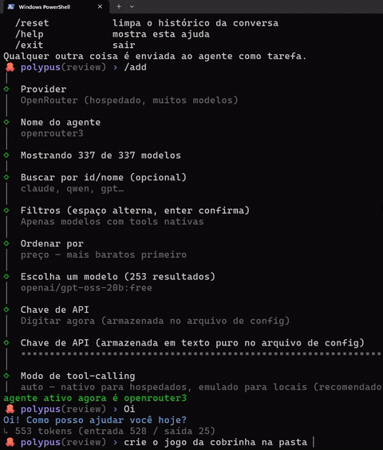
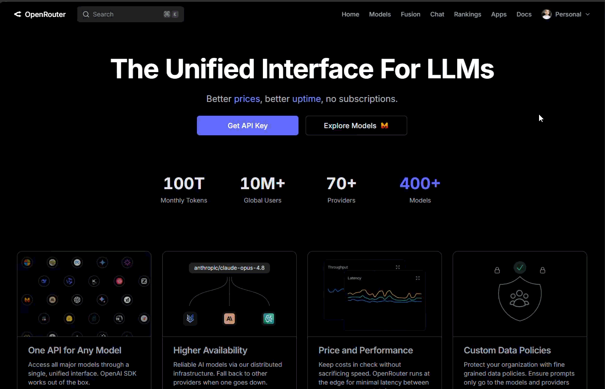
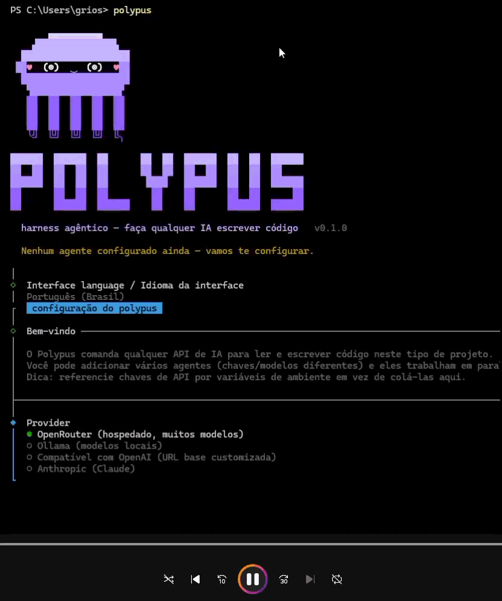

<div align="center">

# 🐙 Polypus

[](https://github.com/GaberRB/polypus/actions/workflows/ci.yml)
[](https://www.npmjs.com/package/@gaberrb/polypus)
[](LICENSE)
[](https://nodejs.org)

**An agentic coding harness that makes *any* AI API write and apply code — even models without native tool-calling.**

[📖 Docs](https://gaberrb.github.io/polypus/) · [📦 npm](https://www.npmjs.com/package/@gaberrb/polypus) · [📝 Changelog](CHANGELOG.md) · [🐛 Issues](https://github.com/GaberRB/polypus/issues)

<p align="center">
  
</p>

</div>

---

## 🌐 Read in your language

<div align="center">

| | | | |
|:---:|:---:|:---:|:---:|
| [🇺🇸 English](#-english) | [🇧🇷 Português](#-português-brasil) | [🇨🇳 中文](#-中文简体) | [🇪🇸 Español](#-español) |
| [🇯🇵 日本語](#-日本語) | [🇰🇷 한국어](#-한국어) | [🇩🇪 Deutsch](#-deutsch) | [🇫🇷 Français](#-français) |
| [🇷🇺 Русский](#-русский) | [🇮🇳 हिन्दी](#-हिन्दी) | | |

</div>

---

## 🇺🇸 English

Polypus is a **terminal-first agentic coding harness**. It connects to any AI provider — OpenRouter, Ollama, Anthropic, or any OpenAI-compatible endpoint — and gives the model a full set of coding tools: read files, write files, run shell commands, search, and more. It works with **any model**, even those without native function-calling, by injecting an XML protocol and parsing it back.

### ✨ Key Features

- 🔌 **Any provider** — OpenRouter, Ollama, Anthropic, or any OpenAI-compatible endpoint
- 🧩 **Tool-calling for every model** — native function-calling for hosted models; XML emulation for local/base models
- 🔐 **Permission modes** — `plan` (read-only), `review` (confirm each action), `bypass` (auto-approve)
- 🐝 **Parallel swarm** — split a task across multiple agents working concurrently in isolated git worktrees
- 🪄 **Setup wizard** — interactive onboarding for keys, models and permissions
- ✅ **Closed-loop verification** — runs your project's own checks (typecheck / build / test / lint) before declaring "done"
- 🗂️ **Project memory** — `.poly/` workspace with a persistent `agents.md` and reusable skills
- 🌎 **Bilingual UI** — Portuguese (pt-BR, default) and English
- 🕵️ **No telemetry** — nothing leaves your machine except calls to the providers you configure

### ⚡ Install

```bash
npm install -g @gaberrb/polypus
```

Requires **Node.js 20+**. After install, run `polypus` — the first run opens the setup wizard automatically.

<details>
<summary>Install from source (for contributors)</summary>

```bash
git clone https://github.com/GaberRB/polypus polypus && cd polypus
npm install
npm run build
npm link        # makes `polypus` available globally
```

</details>

### 🚀 Getting Started

#### Step 1 — Get an OpenRouter API key

OpenRouter gives you access to hundreds of models (including free ones) with a single key.

<!-- GIF: How to create an OpenRouter API key -->
> **📹 Watch:** Creating an OpenRouter key — go to [openrouter.ai/keys](https://openrouter.ai/keys), sign in, click **Create key**, and copy it.

<p align="center">
  
  <!-- TODO: replace placeholder with recorded GIF -->
</p>

#### Step 2 — Add the key to Polypus

<!-- GIF: How to add your API key to Polypus -->
> **📹 Watch:** Run `polypus setup` and paste your key when prompted.

<p align="center">
  
  <!-- TODO: replace placeholder with recorded GIF -->
</p>

```bash
# Option A — interactive wizard (recommended)
polypus setup

# Option B — one-liner
export OPENROUTER_API_KEY=sk-or-...
polypus add-agent or \
  --provider openrouter \
  --model "anthropic/claude-3.5-sonnet" \
  --api-key '${OPENROUTER_API_KEY}'
```

#### Step 3 — Run a task

```bash
polypus run "create a Fastify server in src/server.ts with a /health route"
```

Or open the interactive REPL with just `polypus`.

### 🔍 Discovering Models

Browse the OpenRouter catalog from the terminal:

```bash
polypus models --tools --max-price 1 --sort price   # cheap models with tool support
polypus models --search claude --sort price-desc     # all Claude models
polypus models --free                                # free models only
```

### 🐝 Swarm (Parallel Agents)

```bash
polypus swarm "add a REST API and a matching test suite"
```

A lead agent decomposes the task; workers run in isolated git worktrees in parallel and merge back automatically. Branches that fail verification are kept for manual review, never force-merged.

### 🗂️ Project Memory (`.poly/`)

```bash
polypus init        # scaffold a .poly/ workspace
```

Creates `agents.md` (auto-loaded into every agent's system prompt), `skills/` (focused how-to guides pulled on demand), and a lean SDD spec template.

### 💻 Commands

| Command | Description |
|---|---|
| `polypus setup` | Interactive wizard (agents, keys, permissions) |
| `polypus init [--force]` | Scaffold `.poly/` workspace |
| `polypus run [task]` | Run a task or open a REPL |
| `polypus swarm <task>` | Split task across parallel agents |
| `polypus models [--tools] [--free] [--max-price N]` | Browse OpenRouter catalog |
| `polypus add-agent <name> --provider <p> --model <m>` | Register an agent |
| `polypus list-agents` | List configured agents |

### 🔐 Permission Modes

| Mode | File writes | Commands |
|---|---|---|
| `plan` | blocked | blocked |
| `review` | confirm each | confirm (unless pre-approved) |
| `bypass` | auto | auto |

### ⚙️ Execution Profiles

| Profile | Verification | Plan-first | Auto-context |
|---|---|---|---|
| `quality` (default) | ✅ | ✅ | ✅ |
| `fast` | ❌ | ❌ | ❌ |

```bash
polypus run "..."          # quality by default
polypus run --fast "..."   # cheapest/quickest
```

---

## 🇧🇷 Português (Brasil)

Polypus é um **harness de codificação agêntica orientado ao terminal**. Conecta-se a qualquer provedor de IA — OpenRouter, Ollama, Anthropic, ou qualquer endpoint compatível com OpenAI — e entrega ao modelo um conjunto completo de ferramentas de programação: ler arquivos, escrever arquivos, executar comandos no shell, buscar código e muito mais. Funciona com **qualquer modelo**, até os sem function-calling nativo, injetando um protocolo XML e parseando a resposta.

### ✨ Funcionalidades

- 🔌 **Qualquer provedor** — OpenRouter, Ollama, Anthropic ou endpoint OpenAI-compatível
- 🧩 **Tool-calling para todo modelo** — nativo para modelos hospedados; emulação XML para modelos locais/base
- 🔐 **Modos de permissão** — `plan` (só leitura), `review` (confirmar cada ação), `bypass` (auto-aprovação)
- 🐝 **Swarm paralelo** — divida uma tarefa entre vários agentes em worktrees git isolados
- 🪄 **Wizard de configuração** — onboarding interativo para chaves, modelos e permissões
- ✅ **Verificação em loop fechado** — executa as próprias verificações do projeto (typecheck/build/test/lint) antes de declarar "pronto"
- 🗂️ **Memória do projeto** — workspace `.poly/` com `agents.md` persistente e skills reutilizáveis
- 🌎 **UI bilíngue** — Português (pt-BR, padrão) e Inglês
- 🕵️ **Sem telemetria** — nada sai da sua máquina exceto chamadas aos provedores configurados

### ⚡ Instalação

```bash
npm install -g @gaberrb/polypus
```

Requer **Node.js 20+**. Após instalar, execute `polypus` — o primeiro uso abre o wizard automaticamente.

### 🚀 Primeiros Passos

#### Passo 1 — Crie uma chave no OpenRouter

O OpenRouter dá acesso a centenas de modelos (incluindo gratuitos) com uma única chave.

<!-- GIF: Como criar uma chave de API no OpenRouter -->
> **📹 Assista:** Acesse [openrouter.ai/keys](https://openrouter.ai/keys), faça login, clique em **Create key** e copie a chave.

<p align="center">
  
  <!-- TODO: substituir pelo GIF gravado -->
</p>

#### Passo 2 — Adicione a chave ao Polypus

<!-- GIF: Como adicionar sua chave ao Polypus -->
> **📹 Assista:** Execute `polypus setup` e cole sua chave quando solicitado.

<p align="center">
  
  <!-- TODO: substituir pelo GIF gravado -->
</p>

```bash
# Opção A — wizard interativo (recomendado)
polypus setup

# Opção B — linha de comando
export OPENROUTER_API_KEY=sk-or-...
polypus add-agent or \
  --provider openrouter \
  --model "anthropic/claude-3.5-sonnet" \
  --api-key '${OPENROUTER_API_KEY}'
```

#### Passo 3 — Execute uma tarefa

```bash
polypus run "crie um servidor Fastify em src/server.ts com uma rota /health"
```

Ou abra o REPL interativo digitando apenas `polypus`.

### 🐝 Swarm (Agentes em Paralelo)

```bash
polypus swarm "adicione uma API REST e uma suíte de testes correspondente"
```

### 🗂️ Memória do Projeto (`.poly/`)

```bash
polypus init        # cria o workspace .poly/
```

### 💻 Comandos

| Comando | Descrição |
|---|---|
| `polypus setup` | Wizard interativo (agentes, chaves, permissões) |
| `polypus init [--force]` | Cria o workspace `.poly/` |
| `polypus run [tarefa]` | Executa uma tarefa ou abre o REPL |
| `polypus swarm <tarefa>` | Divide a tarefa entre agentes paralelos |
| `polypus models [--tools] [--free] [--max-price N]` | Navega no catálogo do OpenRouter |
| `polypus add-agent <nome> --provider <p> --model <m>` | Registra um agente |
| `polypus list-agents` | Lista agentes configurados |

---

## 🇨🇳 中文（简体）

Polypus 是一个**以终端为核心的智能编程框架**。它可连接任何 AI 提供商——OpenRouter、Ollama、Anthropic 或任何兼容 OpenAI 的接口——并为模型提供完整的编程工具集：读写文件、执行 Shell 命令、搜索代码等。它适用于**任何模型**，即使是没有原生 function-calling 的模型，也可通过注入 XML 协议并解析返回值来实现。

### ✨ 核心功能

- 🔌 **支持任意提供商** — OpenRouter、Ollama、Anthropic 或 OpenAI 兼容接口
- 🧩 **为所有模型赋予工具调用能力** — 托管模型原生支持；本地/基础模型通过 XML 仿真
- 🔐 **权限模式** — `plan`（只读）、`review`（逐步确认）、`bypass`（自动审批）
- 🐝 **并行 Swarm** — 将任务拆分给多个 Agent，在隔离的 git worktree 中并发执行
- 🪄 **配置向导** — 交互式引导设置密钥、模型和权限
- ✅ **闭环验证** — 完成任务前自动运行项目自身的检查（typecheck/build/test/lint）
- 🗂️ **项目记忆** — `.poly/` 工作区，含持久化 `agents.md` 和可复用技能库
- 🌎 **双语 UI** — 葡萄牙语（pt-BR，默认）和英语
- 🕵️ **零遥测** — 除调用您配置的提供商外，任何数据都不离开您的机器

### ⚡ 安装

```bash
npm install -g @gaberrb/polypus
```

需要 **Node.js 20+**。安装后运行 `polypus`，首次使用将自动打开配置向导。

### 🚀 快速开始

#### 第一步 — 获取 OpenRouter API 密钥

OpenRouter 提供对数百个模型（包括免费模型）的访问，只需一个密钥。

<!-- GIF: 如何创建 OpenRouter API 密钥 -->
> **📹 演示：** 访问 [openrouter.ai/keys](https://openrouter.ai/keys)，登录后点击 **Create key**，复制密钥。

<p align="center">
  
  <!-- TODO: 替换为录制的 GIF -->
</p>

#### 第二步 — 将密钥添加到 Polypus

<!-- GIF: 如何向 Polypus 添加密钥 -->
> **📹 演示：** 运行 `polypus setup`，在提示时粘贴您的密钥。

<p align="center">
  
  <!-- TODO: 替换为录制的 GIF -->
</p>

```bash
# 方式 A — 交互向导（推荐）
polypus setup

# 方式 B — 命令行
export OPENROUTER_API_KEY=sk-or-...
polypus add-agent or \
  --provider openrouter \
  --model "anthropic/claude-3.5-sonnet" \
  --api-key '${OPENROUTER_API_KEY}'
```

#### 第三步 — 执行任务

```bash
polypus run "在 src/server.ts 中创建一个带 /health 路由的 Fastify 服务器"
```

或直接运行 `polypus` 打开交互式 REPL。

### 💻 命令参考

| 命令 | 说明 |
|---|---|
| `polypus setup` | 交互式向导（代理、密钥、权限） |
| `polypus init [--force]` | 初始化 `.poly/` 工作区 |
| `polypus run [任务]` | 执行任务或打开 REPL |
| `polypus swarm <任务>` | 将任务拆分给多个并行代理 |
| `polypus models [--tools] [--free] [--max-price N]` | 浏览 OpenRouter 模型目录 |
| `polypus add-agent <名称> --provider <p> --model <m>` | 注册代理 |
| `polypus list-agents` | 列出已配置的代理 |

---

## 🇪🇸 Español

Polypus es un **harness de codificación agéntica centrado en la terminal**. Se conecta a cualquier proveedor de IA — OpenRouter, Ollama, Anthropic, o cualquier endpoint compatible con OpenAI — y proporciona al modelo un conjunto completo de herramientas: leer y escribir archivos, ejecutar comandos de shell, buscar código, y más. Funciona con **cualquier modelo**, incluso los que no tienen function-calling nativo, mediante un protocolo XML inyectado en el prompt.

### ✨ Características principales

- 🔌 **Cualquier proveedor** — OpenRouter, Ollama, Anthropic o endpoint compatible con OpenAI
- 🧩 **Tool-calling para todos los modelos** — nativo para modelos alojados; emulación XML para modelos locales
- 🔐 **Modos de permiso** — `plan` (solo lectura), `review` (confirmar cada acción), `bypass` (auto-aprobación)
- 🐝 **Swarm paralelo** — divide una tarea entre varios agentes en worktrees git aislados
- 🪄 **Asistente de configuración** — onboarding interactivo para claves, modelos y permisos
- ✅ **Verificación en bucle cerrado** — ejecuta las propias verificaciones del proyecto antes de declarar "listo"
- 🗂️ **Memoria del proyecto** — workspace `.poly/` con `agents.md` persistente y habilidades reutilizables
- 🕵️ **Sin telemetría** — nada sale de tu máquina excepto llamadas a los proveedores configurados

### ⚡ Instalación

```bash
npm install -g @gaberrb/polypus
```

Requiere **Node.js 20+**. Luego ejecuta `polypus` — la primera vez se abre el asistente de configuración automáticamente.

### 🚀 Inicio rápido

#### Paso 1 — Crea una clave de API en OpenRouter

OpenRouter te da acceso a cientos de modelos (incluyendo gratuitos) con una sola clave.

<!-- GIF: Cómo crear una clave de API en OpenRouter -->
> **📹 Mira:** Accede a [openrouter.ai/keys](https://openrouter.ai/keys), inicia sesión, haz clic en **Create key** y cópiala.

<p align="center">
  
  <!-- TODO: reemplazar con GIF grabado -->
</p>

#### Paso 2 — Agrega la clave a Polypus

<!-- GIF: Cómo agregar tu clave a Polypus -->
> **📹 Mira:** Ejecuta `polypus setup` y pega tu clave cuando se te solicite.

<p align="center">
  
  <!-- TODO: reemplazar con GIF grabado -->
</p>

```bash
# Opción A — asistente interactivo (recomendado)
polypus setup

# Opción B — línea de comandos
export OPENROUTER_API_KEY=sk-or-...
polypus add-agent or \
  --provider openrouter \
  --model "anthropic/claude-3.5-sonnet" \
  --api-key '${OPENROUTER_API_KEY}'
```

#### Paso 3 — Ejecuta una tarea

```bash
polypus run "crea un servidor Fastify en src/server.ts con una ruta /health"
```

---

## 🇯🇵 日本語

Polypus は**ターミナルファーストのエージェント型コーディングハーネス**です。OpenRouter・Ollama・Anthropic・OpenAI 互換エンドポイントなど、どんな AI プロバイダーにも接続でき、モデルにファイルの読み書き・シェルコマンドの実行・コード検索などの完全なツールセットを提供します。ネイティブの function-calling がないモデルでも、XML プロトコルの注入と解析により**あらゆるモデル**で動作します。

### ✨ 主な機能

- 🔌 **任意のプロバイダー** — OpenRouter・Ollama・Anthropic・OpenAI 互換エンドポイント
- 🧩 **全モデルにツール呼び出し** — ホスト型モデルはネイティブ、ローカル/ベースモデルは XML エミュレーション
- 🔐 **パーミッションモード** — `plan`（読み取り専用）、`review`（各操作を確認）、`bypass`（自動承認）
- 🐝 **並列スウォーム** — 複数エージェントが隔離された git worktree で並行実行
- 🪄 **セットアップウィザード** — キー・モデル・パーミッションのインタラクティブ設定
- ✅ **クローズドループ検証** — 「完了」を宣言する前にプロジェクト独自のチェックを実行
- 🗂️ **プロジェクトメモリ** — `.poly/` ワークスペースと再利用可能なスキル
- 🕵️ **テレメトリなし** — 設定したプロバイダーへの呼び出し以外、データは機外に出ません

### ⚡ インストール

```bash
npm install -g @gaberrb/polypus
```

**Node.js 20+** が必要です。インストール後に `polypus` を実行すると、初回はセットアップウィザードが自動で起動します。

### 🚀 クイックスタート

#### ステップ 1 — OpenRouter の API キーを取得する

OpenRouter は1つのキーで数百のモデル（無料モデルを含む）にアクセスできます。

<!-- GIF: OpenRouter API キーの作成方法 -->
> **📹 デモ：** [openrouter.ai/keys](https://openrouter.ai/keys) にアクセスし、ログイン後に **Create key** をクリックしてキーをコピーします。

<p align="center">
  
  <!-- TODO: 録画した GIF に差し替え -->
</p>

#### ステップ 2 — Polypus にキーを追加する

<!-- GIF: Polypus にキーを追加する方法 -->
> **📹 デモ：** `polypus setup` を実行し、プロンプトが表示されたらキーを貼り付けます。

<p align="center">
  
  <!-- TODO: 録画した GIF に差し替え -->
</p>

```bash
# 方法 A — インタラクティブウィザード（推奨）
polypus setup

# 方法 B — コマンドライン
export OPENROUTER_API_KEY=sk-or-...
polypus add-agent or \
  --provider openrouter \
  --model "anthropic/claude-3.5-sonnet" \
  --api-key '${OPENROUTER_API_KEY}'
```

#### ステップ 3 — タスクを実行する

```bash
polypus run "/health ルートを持つ Fastify サーバーを src/server.ts に作成して"
```

---

## 🇰🇷 한국어

Polypus는 **터미널 중심의 에이전트형 코딩 하니스**입니다. OpenRouter, Ollama, Anthropic, 또는 OpenAI 호환 엔드포인트 등 어떤 AI 공급자에도 연결할 수 있으며, 파일 읽기/쓰기, 셸 명령 실행, 코드 검색 등 완전한 도구 세트를 모델에 제공합니다. 네이티브 function-calling이 없는 모델도 XML 프로토콜 주입과 파싱을 통해 동작합니다.

### ✨ 주요 기능

- 🔌 **모든 공급자 지원** — OpenRouter, Ollama, Anthropic, OpenAI 호환 엔드포인트
- 🧩 **모든 모델에 도구 호출** — 호스팅 모델은 네이티브, 로컬/베이스 모델은 XML 에뮬레이션
- 🔐 **권한 모드** — `plan` (읽기 전용), `review` (각 작업 확인), `bypass` (자동 승인)
- 🐝 **병렬 스웜** — 격리된 git worktree에서 여러 에이전트가 동시 실행
- 🪄 **설정 마법사** — 키, 모델, 권한의 인터랙티브 온보딩
- ✅ **폐쇄 루프 검증** — 완료 선언 전 프로젝트 자체 검사(typecheck/build/test/lint) 실행
- 🕵️ **텔레메트리 없음** — 설정한 공급자 호출 외에는 데이터가 머신을 벗어나지 않음

### ⚡ 설치

```bash
npm install -g @gaberrb/polypus
```

**Node.js 20+** 필요. 설치 후 `polypus` 실행 — 첫 실행 시 설정 마법사가 자동으로 열립니다.

### 🚀 시작하기

#### 1단계 — OpenRouter API 키 발급

<!-- GIF: OpenRouter API 키 생성 방법 -->
> **📹 시연:** [openrouter.ai/keys](https://openrouter.ai/keys)에 접속, 로그인 후 **Create key** 클릭, 키를 복사합니다.

<p align="center">
  
  <!-- TODO: 녹화한 GIF로 교체 -->
</p>

#### 2단계 — Polypus에 키 추가

<!-- GIF: Polypus에 키 추가하는 방법 -->
> **📹 시연:** `polypus setup` 실행 후 키를 붙여넣습니다.

<p align="center">
  
  <!-- TODO: 녹화한 GIF로 교체 -->
</p>

```bash
# 방법 A — 인터랙티브 마법사 (권장)
polypus setup

# 방법 B — 커맨드라인
export OPENROUTER_API_KEY=sk-or-...
polypus add-agent or \
  --provider openrouter \
  --model "anthropic/claude-3.5-sonnet" \
  --api-key '${OPENROUTER_API_KEY}'
```

#### 3단계 — 작업 실행

```bash
polypus run "src/server.ts에 /health 라우트를 가진 Fastify 서버를 만들어줘"
```

---

## 🇩🇪 Deutsch

Polypus ist ein **terminal-zentriertes agentisches Coding-Harness**. Es verbindet sich mit jedem KI-Anbieter — OpenRouter, Ollama, Anthropic oder einem OpenAI-kompatiblen Endpunkt — und gibt dem Modell ein vollständiges Werkzeugset: Dateien lesen/schreiben, Shell-Befehle ausführen, Code suchen und mehr. Es funktioniert mit **jedem Modell**, auch ohne natives Function-Calling, durch ein injiziertes XML-Protokoll.

### ✨ Hauptfunktionen

- 🔌 **Beliebiger Anbieter** — OpenRouter, Ollama, Anthropic oder OpenAI-kompatibler Endpunkt
- 🧩 **Tool-Calling für alle Modelle** — nativ für gehostete Modelle; XML-Emulation für lokale Modelle
- 🔐 **Berechtigungsmodi** — `plan` (nur lesen), `review` (jede Aktion bestätigen), `bypass` (auto-genehmigen)
- 🐝 **Paralleler Schwarm** — Aufgabe auf mehrere Agenten in isolierten git-Worktrees aufteilen
- ✅ **Geschlossener Überprüfungskreis** — führt Projektprüfungen aus, bevor „fertig" deklariert wird
- 🕵️ **Keine Telemetrie** — nichts verlässt Ihren Rechner außer Aufrufen an die konfigurierten Anbieter

### ⚡ Installation

```bash
npm install -g @gaberrb/polypus
```

Erfordert **Node.js 20+**. Nach der Installation `polypus` ausführen — beim ersten Start öffnet sich automatisch der Setup-Wizard.

### 🚀 Schnellstart

#### Schritt 1 — OpenRouter API-Schlüssel erstellen

<!-- GIF: OpenRouter API-Schlüssel erstellen -->
> **📹 Demo:** Besuchen Sie [openrouter.ai/keys](https://openrouter.ai/keys), melden Sie sich an, klicken Sie auf **Create key** und kopieren Sie den Schlüssel.

<p align="center">
  
  <!-- TODO: durch aufgezeichnetes GIF ersetzen -->
</p>

#### Schritt 2 — Schlüssel zu Polypus hinzufügen

<!-- GIF: Schlüssel zu Polypus hinzufügen -->
> **📹 Demo:** Führen Sie `polypus setup` aus und fügen Sie Ihren Schlüssel ein, wenn Sie dazu aufgefordert werden.

<p align="center">
  
  <!-- TODO: durch aufgezeichnetes GIF ersetzen -->
</p>

```bash
# Option A — interaktiver Wizard (empfohlen)
polypus setup

# Option B — Befehlszeile
export OPENROUTER_API_KEY=sk-or-...
polypus add-agent or \
  --provider openrouter \
  --model "anthropic/claude-3.5-sonnet" \
  --api-key '${OPENROUTER_API_KEY}'
```

---

## 🇫🇷 Français

Polypus est un **harness de codage agentique centré sur le terminal**. Il se connecte à n'importe quel fournisseur d'IA — OpenRouter, Ollama, Anthropic ou tout endpoint compatible OpenAI — et fournit au modèle un jeu d'outils complet : lire/écrire des fichiers, exécuter des commandes shell, rechercher du code, etc. Il fonctionne avec **n'importe quel modèle**, même sans function-calling natif, grâce à un protocole XML injecté dans le prompt.

### ✨ Fonctionnalités clés

- 🔌 **N'importe quel fournisseur** — OpenRouter, Ollama, Anthropic ou endpoint compatible OpenAI
- 🧩 **Tool-calling pour tous les modèles** — natif pour les modèles hébergés ; émulation XML pour les modèles locaux
- 🔐 **Modes de permission** — `plan` (lecture seule), `review` (confirmer chaque action), `bypass` (auto-approbation)
- 🐝 **Swarm parallèle** — répartir une tâche entre plusieurs agents dans des worktrees git isolés
- ✅ **Vérification en boucle fermée** — exécute les vérifications du projet avant de déclarer « terminé »
- 🕵️ **Sans télémétrie** — rien ne quitte votre machine sauf les appels aux fournisseurs configurés

### ⚡ Installation

```bash
npm install -g @gaberrb/polypus
```

Nécessite **Node.js 20+**. Après l'installation, exécutez `polypus` — le premier lancement ouvre automatiquement l'assistant de configuration.

### 🚀 Démarrage rapide

#### Étape 1 — Créer une clé API OpenRouter

<!-- GIF : Comment créer une clé API OpenRouter -->
> **📹 Démo :** Rendez-vous sur [openrouter.ai/keys](https://openrouter.ai/keys), connectez-vous, cliquez sur **Create key** et copiez la clé.

<p align="center">
  
  <!-- TODO : remplacer par le GIF enregistré -->
</p>

#### Étape 2 — Ajouter la clé à Polypus

<!-- GIF : Comment ajouter votre clé à Polypus -->
> **📹 Démo :** Exécutez `polypus setup` et collez votre clé lorsque demandé.

<p align="center">
  
  <!-- TODO : remplacer par le GIF enregistré -->
</p>

```bash
# Option A — assistant interactif (recommandé)
polypus setup

# Option B — ligne de commande
export OPENROUTER_API_KEY=sk-or-...
polypus add-agent or \
  --provider openrouter \
  --model "anthropic/claude-3.5-sonnet" \
  --api-key '${OPENROUTER_API_KEY}'
```

---

## 🇷🇺 Русский

Polypus — это **агентный хarness для написания кода, ориентированный на терминал**. Он подключается к любому провайдеру ИИ — OpenRouter, Ollama, Anthropic или любому OpenAI-совместимому эндпоинту — и предоставляет модели полный набор инструментов: чтение/запись файлов, выполнение команд в shell, поиск кода и многое другое. Работает с **любой моделью**, даже без нативного function-calling, с помощью инъекции XML-протокола.

### ✨ Ключевые возможности

- 🔌 **Любой провайдер** — OpenRouter, Ollama, Anthropic или OpenAI-совместимый эндпоинт
- 🧩 **Tool-calling для всех моделей** — нативно для хостинговых; XML-эмуляция для локальных
- 🔐 **Режимы разрешений** — `plan` (только чтение), `review` (подтверждать каждое действие), `bypass` (авто-одобрение)
- 🐝 **Параллельный swarm** — разбить задачу между несколькими агентами в изолированных git-worktrees
- ✅ **Верификация в замкнутом цикле** — выполняет проверки проекта перед объявлением «готово»
- 🕵️ **Без телеметрии** — данные не покидают вашу машину кроме вызовов настроенных провайдеров

### ⚡ Установка

```bash
npm install -g @gaberrb/polypus
```

Требует **Node.js 20+**. После установки запустите `polypus` — при первом запуске откроется мастер настройки.

### 🚀 Быстрый старт

#### Шаг 1 — Создать API-ключ в OpenRouter

<!-- GIF: Как создать API-ключ OpenRouter -->
> **📹 Демо:** Перейдите на [openrouter.ai/keys](https://openrouter.ai/keys), войдите в аккаунт, нажмите **Create key** и скопируйте ключ.

<p align="center">
  
  <!-- TODO: заменить записанным GIF -->
</p>

#### Шаг 2 — Добавить ключ в Polypus

<!-- GIF: Как добавить ключ в Polypus -->
> **📹 Демо:** Запустите `polypus setup` и вставьте ключ при запросе.

<p align="center">
  
  <!-- TODO: заменить записанным GIF -->
</p>

```bash
# Вариант A — интерактивный мастер (рекомендуется)
polypus setup

# Вариант B — командная строка
export OPENROUTER_API_KEY=sk-or-...
polypus add-agent or \
  --provider openrouter \
  --model "anthropic/claude-3.5-sonnet" \
  --api-key '${OPENROUTER_API_KEY}'
```

---

## 🇮🇳 हिन्दी

Polypus एक **टर्मिनल-फर्स्ट एजेंटिक कोडिंग हार्नेस** है। यह किसी भी AI प्रोवाइडर — OpenRouter, Ollama, Anthropic, या किसी OpenAI-compatible एंडपॉइंट — से जुड़ता है और मॉडल को एक पूरा टूल सेट देता है: फाइलें पढ़ना/लिखना, shell कमांड चलाना, कोड खोजना और बहुत कुछ। यह **किसी भी मॉडल** के साथ काम करता है, यहाँ तक कि बिना native function-calling वाले मॉडल के साथ भी।

### ✨ मुख्य विशेषताएँ

- 🔌 **कोई भी प्रोवाइडर** — OpenRouter, Ollama, Anthropic या OpenAI-compatible एंडपॉइंट
- 🧩 **सभी मॉडल के लिए tool-calling** — hosted मॉडल के लिए native; local मॉडल के लिए XML emulation
- 🔐 **Permission modes** — `plan` (read-only), `review` (हर action confirm करें), `bypass` (auto-approve)
- 🐝 **Parallel Swarm** — एक task को कई agents में बाँटें, अलग-अलग git worktrees में
- ✅ **Closed-loop verification** — "done" declare करने से पहले project के खुद के checks चलाता है
- 🕵️ **कोई telemetry नहीं** — configured providers को calls के अलावा कोई data आपकी machine नहीं छोड़ता

### ⚡ इंस्टॉल करें

```bash
npm install -g @gaberrb/polypus
```

**Node.js 20+** जरूरी है। इंस्टॉल के बाद `polypus` चलाएँ — पहली बार में setup wizard खुद खुल जाएगा।

### 🚀 शुरुआत कैसे करें

#### Step 1 — OpenRouter API key बनाएँ

<!-- GIF: OpenRouter API key कैसे बनाएँ -->
> **📹 देखें:** [openrouter.ai/keys](https://openrouter.ai/keys) पर जाएँ, login करें, **Create key** पर click करें और key copy करें।

<p align="center">
  
  <!-- TODO: recorded GIF से replace करें -->
</p>

#### Step 2 — Polypus में key add करें

<!-- GIF: Polypus में key कैसे add करें -->
> **📹 देखें:** `polypus setup` चलाएँ और prompt पर key paste करें।

<p align="center">
  
  <!-- TODO: recorded GIF से replace करें -->
</p>

```bash
# Option A — interactive wizard (recommended)
polypus setup

# Option B — command line
export OPENROUTER_API_KEY=sk-or-...
polypus add-agent or \
  --provider openrouter \
  --model "anthropic/claude-3.5-sonnet" \
  --api-key '${OPENROUTER_API_KEY}'
```

#### Step 3 — Task run करें

```bash
polypus run "src/server.ts में /health route के साथ एक Fastify server बनाओ"
```

---

## 🔧 Advanced Topics (All Languages)

<details>
<summary><strong>MCP (Model Context Protocol)</strong></summary>

Connect external tool servers to give the agent extra capabilities. Declare them in `.poly/mcp.json`:

```json
{
  "mcpServers": {
    "filesystem": {
      "command": "npx",
      "args": ["-y", "@modelcontextprotocol/server-filesystem", "."]
    }
  }
}
```

</details>

<details>
<summary><strong>Autonomous Agent (CI self-improvement)</strong></summary>

Label a GitHub issue `polypus-go` → Polypus estimates cost and posts a comment. Comment `/polypus approve` on the issue → Polypus implements headlessly, gates on CI, bumps the version, and opens a PR.

```
issue + label `polypus-go`
  → estimates cost → you comment `/polypus approve`
  → implements → CI gate → version bump → opens PR
  → you merge → auto-release → npm publish
```

📖 [Full autonomous agent guide](https://gaberrb.github.io/polypus/agent.html)

</details>

<details>
<summary><strong>How non-tool models "code" (XML emulation)</strong></summary>

For models without native function-calling, Polypus injects a strict XML protocol into the system prompt:

```xml
<polypus:tool name="write_file">
<arg name="path">src/index.ts</arg>
<arg name="content">console.log("hello");</arg>
</polypus:tool>
```

Set the mode per agent with `--tool-mode`: `auto` (native for hosted, emulated for Ollama), `native`, or `emulated`.

</details>

<details>
<summary><strong>Configuration reference</strong></summary>

Config stored at `~/.polypus/config.json` (override directory with `POLYPUS_HOME`).

```json
{
  "version": 1,
  "locale": "en",
  "defaultAgent": "or",
  "agents": [
    {
      "name": "or",
      "provider": "openrouter",
      "model": "anthropic/claude-3.5-sonnet",
      "apiKey": "${OPENROUTER_API_KEY}",
      "toolMode": "auto"
    }
  ],
  "permissions": {
    "mode": "review",
    "allow": ["**/*"],
    "deny": [".git/**", ".polypus/**", "**/.env"]
  },
  "execution": {
    "profile": "quality",
    "verify": true,
    "planFirst": true,
    "autoContext": true
  }
}
```

Polypus also loads `~/.polypus/.env` at startup — keep your secrets there:

```dotenv
OPENROUTER_API_KEY=sk-or-...
```

</details>

<details>
<summary><strong>Timeout configuration</strong></summary>

| Env variable | Default | Description |
|---|---|---|
| `POLYPUS_SWARM_OVERALL_TIMEOUT_MS` | 3600000 (1h) | Max duration of a swarm session |
| `POLYPUS_SWARM_IDLE_TIMEOUT_MS` | 300000 (5m) | Idle timeout for individual workers |
| `POLYPUS_PYTHON_TIMEOUT_MS` | 120000 (2m) | Per-script timeout for `run_python_script` |

</details>

---

## 🤝 Contributing

Contributions are welcome — but **open an issue first**. Issues need the `accepted` label before any PR; PRs without a linked accepted issue don't pass CI. See [CONTRIBUTING.md](CONTRIBUTING.md) for the full flow.

## ❤️ Support the project

If Polypus helped you, consider supporting development via **PIX** 💜

> **PIX key (e-mail):** `gabrielriosbelmiro@gmail.com`

Any amount is very welcome and helps keep the project alive. Thank you!

## 👤 Author

**Gabriel Rios**

[](https://github.com/GaberRB)
[](https://www.linkedin.com/in/gabriel-riosb/)

## 📄 License

[MIT](LICENSE) © Gabriel Rios
